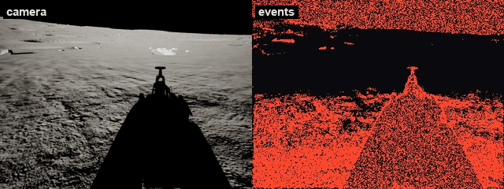

# UnrealEventCam

A simulated event (DVS) camera for Unreal: it renders the scene, generates
brightness-change events with the ESIM model, and streams them to ROS over TCP.

*The rover driving in MARE: the camera (left) and the events
accumulated per frame (right; blue brighter, red darker).*

Part of [MARE](https://github.com/raulcastar/MARE-Lunar-Simulator), an open-source lunar rover
simulation suite. In its ROS 2 stack,
[GNC-Moon-Simulator](https://github.com/raulcastar/GNC-Moon-Simulator), the `component_event_camera` node receives the events on port 3005.

## Requirements

Unreal Engine 5.7 on Windows (the version it is developed and tested with).
Building from source also needs Visual Studio 2022 with the *Game development
with C++* workload.

On the ROS side: ROS 2 Jazzy (Ubuntu 24.04), with the
`component_event_camera` node of GNC-Moon-Simulator receiving the stream. The plugin itself has no ROS
dependency: any program that reads the [wire format](docs/wire-format.md) can use it.

## Install

- **Prebuilt (UE 5.7, Win64):** download `UnrealEventCam-<version>-UE5.7-Win64.zip`
  from [Releases](https://github.com/raulcastar/UnrealEventCam/releases) and extract it
  into `<YourProject>/Plugins/`.
- **From source:** clone this repository into `<YourProject>/Plugins/UnrealEventCam`,
  open the project and answer **Yes** to rebuild the module.

Then check it is enabled under *Edit → Plugins → Project → Other*.

## Use

1. Add a **SceneCaptureComponent2D** named `EventCam` where the sensor sits.
2. Add the **UnrealEventCam** component to the same actor.
3. Press Play: events go to `127.0.0.1:3005`.

Events are only as accurate as the frame rate: keep the editor's FPS high and
steady (see [How it works](docs/how-it-works.md)).

## Dependencies

None to build or run: only engine modules. It stamps its data with the shared
simulation time (its own copy of `GncSimTime.h`); add
[UnrealSimClock](https://github.com/raulcastar/UnrealSimClock) so ROS gets `/clock` on the same time base.

## Docs

| | |
|---|---|
| [Setup in detail](docs/setup.md) | Installing, the capture, the component |
| [Parameters](docs/parameters.md) | Network, camera and model settings |
| [How it works](docs/how-it-works.md) | Event cameras, the ESIM model, its limits |
| [Wire format and ROS](docs/wire-format.md) | The TCP packet layout |
| [Making a release](docs/release.md) | Building the prebuilt zip for GitHub releases |

## License

[MIT](LICENSE), © 2026 Raul Castilla Arquillo. The event model is ported from
[ESIM (rpg_esim)](https://github.com/uzh-rpg/rpg_esim), MIT, © 2018 Robotics and
Perception Group, University of Zurich.
